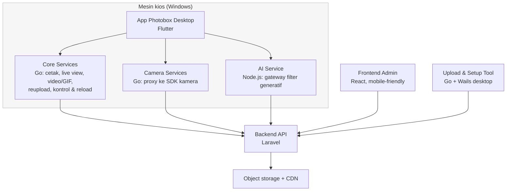

<div align="center">

# Monoframe

**Sistem photobox kiosk end-to-end — capture, filter AI, cetak, video, dan manajemen jarak jauh.**

Dokumentasi publik. Source code berjalan di repository privat dan tidak termasuk ruang lingkup repo ini.

</div>

---

Monoframe adalah produk yang kubangun dari nol: satu mesin photobox yang berdiri sendiri di lokasi bisnis, ditambah seluruh perangkat lunak yang membuatnya bisa beroperasi — aplikasi kios, API backend, dashboard operator, layanan cetak, layanan kamera, layanan AI, dan tool provisioning.

Repo ini **bukan** tempat kode. Isinya review produk dan arsitektur: apa yang dikerjakan sistem ini, bagaimana service-nya bekerja sama, dan angka-angka yang bisa diverifikasi dari kondisi project sebenarnya.

## Masalah yang dipecahkan

Photobox konventional punya dua titik lemah: operator buta terhadap kondisi mesin, dan pelanggan kehilangan momen saat jaringan bermasalah.

| Tanpa sistem | Dengan Monoframe |
|---|---|
| Stok kertas/kegagalan cetak diketahui setelah pelanggan protes | Status printer dan sesi dipantau real-time dari dashboard |
| Internet putus berarti kios berhenti melayani | Antrean capture tetap jalan lokal, lalu sinkron otomatis saat jaringan pulih |
| Aset yang gagal unggah hilang | Operator bisa mengaudit dan me-regenerate aset tanpa menyentuh server |
| Setup kios butuh teknisi ke lokasi | Tool desktop untuk provisioning dan unggah massal aset/bingkai |

## Alur pengalaman pelanggan

Tiga belas layar, dari berdiri di depan kios sampai mengambil hasil cetakan:

```mermaid
flowchart LR
    A[Landing] --> B[Panduan / input email]
    B --> C[Pilih jumlah foto]
    C --> D[Pilih metode bayar]
    D --> E[QRIS atau kode voucher]
    E --> F[Pembayaran sukses]
    F --> G[Timer mulai]
    G --> H[Pilih bingkai]
    H --> I[Capture + retake]
    I --> J[Filter AI / pratinjau cetak]
    J --> K[Mencetak]
    K --> L[Barcode galeri digital]
    L --> M[Terima kasih]
    M --> A
```



Hasil satu sesi bisa berbentuk empat hal sekaligus: cetak fisik, galeri digital, klip video, dan GIF.

## Topologi service

Tujuh service, lima stack, masing-masing repository dan pipeline build sendiri.



| Service | Tanggung jawab | Stack |
|---|---|---|
| App Photobox Desktop | Seluruh interaksi pelanggan di kios | Flutter / Dart |
| Backend API | Autentikasi kios, orkestrasi sesi, CDN, provisioning | Laravel, PHP |
| Frontend Admin | Dashboard operator: stok, kesehatan perangkat, audit sesi | React, Vite |
| Core Services | Cetak, live view, render video/GIF, reupload, kontrol & reload kios | Go |
| Camera Services | Capture dari beberapa vendor kamera lewat proxy SDK | Go |
| AI Service | Gateway ke model generatif untuk filter, termasuk kebijakan antrean multi-provider | Node.js, Express |
| Upload & Setup Tool | Provisioning kios dan unggah aset/bingkai dari desktop | Go + Wails |

Nama vendor kamera, provider pembayaran, model AI, topologi jaringan, dan skema database sengaja tidak dipublikasi.

## Angka yang kuukur dari project ini

Bukan estimasi — dihitung dari file yang di-track git di masing-masing repository service (dependensi, hasil build, dan file terkompilasi dikecualikan).

| Ukuran | Nilai |
|---|---|
| Baris source | 322.334 |
| File source (Dart, PHP, Go, JS/TS) | 1.616 |
| Endpoint REST (v1 + v2) | 392 |
| Migrasi database | 88 |
| Model Eloquent | 35 |
| Test file Flutter | 156 |
| Test file Laravel | 71 |
| Repository service | 7, masing-masing dengan branch sendiri |
| Versi aktif | kontrol kios 0.11.1; layanan native kios 0.10.x |

Distribusi baris per service:

```
App Photobox Desktop      148.973  ████████████████████████████
Frontend Admin             61.692  ████████████
Backend API                56.159  ██████████
Core Services              41.832  ████████
Camera Services             3.909  █
AI Service                  5.011  █
Upload & Setup Tool         4.758  █
```

## Yang menurutku paling sulit (dan menarik)

Ringkas ada di [docs/APP_REVIEW.md](docs/APP_REVIEW.md); topologi dan batasan desain ada di [docs/ARCHITECTURE.md](docs/ARCHITECTURE.md).

Intinya: menjaga mesin tetap melayani saat jaringan putus, tanpa membuat operator kehilangan jejak audit; dan menyatukan tiga dunia (Flutter desktop, Go native, Laravel) yang gagal total kalau satu di antaranya punya asumsi versi yang berbeda — karena itu versi dibangun dari satu sumber kebenaran (`VERSIONS.ini`) dan build tidak pernah dijalankan manual.

## Status

Aktif dikembangkan. Fase sekarang pengerasan kualitas: audit sesi pelanggan, regenerasi aset yang gagal, normalisasi provider AI, dan pengetatan perilaku offline. Kode ditulis dengan test-first pada area berisiko (puluhan test dijalankan tiap perubahan pada antrean cetak dan sinkronisasi).

## Lisensi & batasan

Dokumentasi di repo ini disediakan untuk keperluan portofolio dan penjelasan teknis. Source code, desain antarmuka, dan arsitektur internals adalah milik proyek dan tidak dilisensikan untuk penggunaan ulang.

Rosul Iman — [rosuliman.my.id](https://rosuliman.my.id)
