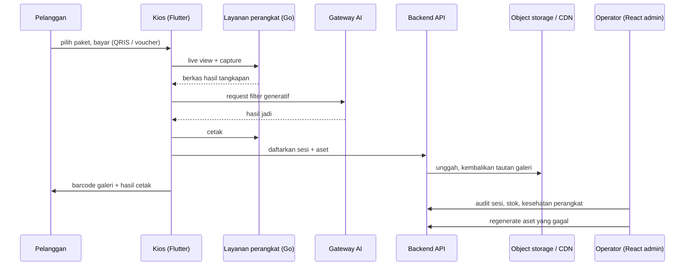

# Arsitektur Monoframe (versi publik)

Versi ini sengaja abstrak: peran service dan arah data, tanpa nomor port, nama endpoint, skema database, nama vendor SDK, provider pembayaran, maupun topologi jaringan produksi.

## Prinsip desain

1. **Monorepo, bukan monolit.** Tujuh service, tujuh repository git dengan branch masing-masing. Tidak ada repository di root monorepo; satu perubahan masuk ke service yang memiliki logikanya.
2. **Kios adalah sumber kebenaran sementara.** Mesin tetap bisa menangkap dan mengantrekan hasil tanpa koneksi. Server menjadi kebenaran setelah sinkron.
3. **Perangkat keras dibungkus layanan kecil.** Kamera dan printer tidak diakses langsung dari UI; masing-masing di belakang service Go dengan kontrak HTTP, sehingga vendor perangkat bisa diganti tanpa mengubah aplikasi kios.
4. **Satu sumber versi.** Versi layanan native dibangun dari satu berkas konfigurasi, dan build dilakukan lewat skrip — bukan perintah build manual — supaya artefak di kios konsisten dengan yang diunggah.
5. **Tool terpisah untuk operator.** Provisioning kios dan unggah aset desktop bukan bagian dari aplikasi kios; keduanya service sendiri agar kegagalan tool tidak mengganggu mesin yang sedang melayani pelanggan.

## Arah data satu sesi

Kalau jaringan putus di tengah jalan, langkah `capture -> antrean lokal` tetap selesai; unggah dan pendaftaran sesi ditunda sampai koneksi pulih, lalu masuk antrean reupload.

## Komposisi layanan native

Lima proses Go berjalan di mesin kios, masing-masing dengan siklus hidupnya sendiri: cetak, live view, render video/GIF, reupload, dan kontrol/reload. Layanan kamera berdiri terpisah sebagai proxy ke SDK vendor, sehingga kegagalan driver kamera tidak menghentikan proses cetak.

Build orchestrated lewat skrip per layanan, dengan penanda build untuk aplikasi desktop; bypass ke perintah build langsung merusak penyisipan aset dan metadata versi.

## Batasan yang kuterima

- **State kios menumpuk di satu proses desktop.** Praktis untuk produk yang harus jalan offline, mahal untuk pengujian dan perubahan lifecycle.
- **Dua versi API hidup bersamaan.** Migrasi bertahap berarti permukaan pengujian melebar.
- **Aset bisa berada di tiga tempat sekaligus** (mesin, antrean lokal, object storage). Tanpa identitas aset yang stabil sejak dibuat, audit menjadi tidak mungkin — itu alasan fitur audit sesi dan regenerate sekarang dibangun.

## Apa yang tidak ada di dokumen publik ini

Skema relasi basis data, daftar endpoint, nomor port, kredensial dan berkas lingkungan, nama vendor SDK kamera, provider pembayaran, penyedia model AI, isi laporan audit keamanan, serta seluruh kode sumber. Semuanya ada di repository privat proyek.
